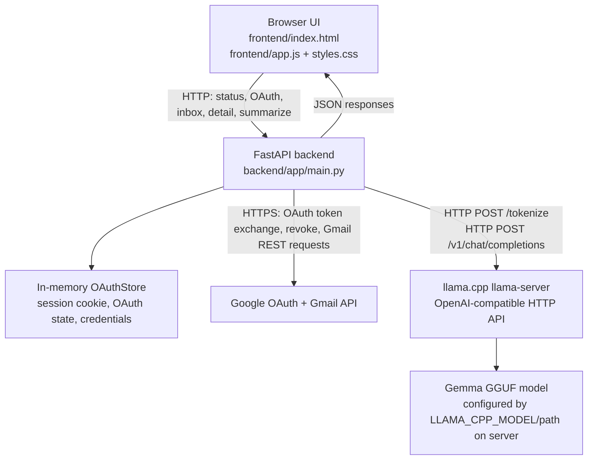

# Talkie Mail

Talkie Mail is a local-first email companion that helps a person make sense of
their Gmail inbox one message at a time. Buddy is the friendly character in the
browser experience: Buddy guides first-time setup, provides the onboarding
welcome and connection confirmation, and presents concise summaries when the
user asks for one.

The current application is intended for a single local development user. Gmail
is accessed through Google's API, while email summarization is sent to a
llama.cpp server running on the same machine.

## Features

Verified in the current code:

- FastAPI application with a `/health` endpoint.
- Gmail OAuth 2.0 authorization for read-only inbox access.
- PKCE OAuth authorization flow with one-time, server-side state.
- In-memory session and credential storage for the running process.
- Inbox listing with bounded pagination (`max_results` 1–50).
- Inbox message detail retrieval with plain-text extraction and safe structured
  rendering for HTML-only messages.
- Filtering so only messages carrying Gmail's `INBOX` label can be opened or
  summarized.
- Local email summarization through an OpenAI-compatible llama.cpp endpoint.
- Token-aware prompt fitting for the configured model context window.
- Validation of the summary schema: `gist`, `key_points`, and `action_items`.
- A bounded retry for incomplete model JSON; malformed output is reported as a
  failure rather than fabricated into a summary.
- Optional Redis-backed caching of validated summaries, with a configurable
  TTL and graceful fallback to llama.cpp when Redis is unavailable.
- Buddy onboarding, confirmed-connection celebration, existing inbox dashboard,
  email selection, summary loading state, retry state, and a three-step
  dashboard walkthrough.
- Reduced-motion handling in the frontend.

Incomplete or planned:

- Credentials are not persisted across backend restarts and the current
  in-memory store is not suitable for multiple users or production deployment.
- No persistent database is implemented.
- Live voice conversation is planned but is not implemented in this repository.
- The application does not download models or manage a llama.cpp process.
- Real Gmail and production OAuth deployment require environment-specific
  configuration and were not treated as automated test fixtures.

## Architecture



The browser communicates with FastAPI over HTTP. FastAPI communicates with
Google over HTTPS for OAuth and Gmail requests. FastAPI communicates with the
local llama.cpp server over HTTP for tokenization and chat completion. The
browser never receives Gmail access or refresh tokens.

## Technology stack

- Python 3.13 in the currently configured virtual environment. No minimum or
  maximum Python version is declared by the dependency manifest.
- FastAPI and Uvicorn for the backend HTTP application.
- Pydantic Settings for environment-based configuration.
- `google-auth-oauthlib` and Google OAuth 2.0 for authorization.
- `requests` for Gmail and local model HTTP calls.
- HTML, CSS, and vanilla JavaScript for the frontend.
- Gmail API for read-only inbox access.
- llama.cpp `llama-server` for local inference.
- Gemma 4 E2B IT in GGUF format, using the configured `gemma` server alias.
  The currently verified local file is a Q4_0 quantization, but model weights
  are not part of this repository.

llama.cpp is used so the selected model can run locally without adding a
hosted inference service or a frontend model dependency. The server exposes an
OpenAI-compatible chat-completions route used by the backend.

## Project structure

```text
.
├── .env.example
├── .gitignore
├── assets/
│   └── buddy_*.png
├── backend/
│   ├── requirements.txt
│   ├── app/
│   │   ├── config.py       # Environment settings and validation
│   │   ├── gmail.py        # Gmail REST access and message extraction
│   │   ├── main.py         # FastAPI routes and error mapping
│   │   ├── oauth.py        # OAuth/PKCE flow and in-memory sessions
│   │   └── summarizer.py   # Local model request and schema validation
│   └── tests/
│       └── test_main.py    # API, OAuth, Gmail, summarizer, and frontend contracts
└── frontend/
    ├── app.js              # Onboarding, dashboard, inbox, and summary behavior
    ├── index.html          # Application shell and accessible markup
    ├── styles.css          # Layout, Buddy states, and motion
    └── assets/buddy/       # Canonical SVG and asset notes
```

## Prerequisites

- Git.
- Python 3.13 is verified in the current development environment. Because
  `backend/requirements.txt` has no Python version marker, confirm the version
  used by your team before deployment.
- A built or installed llama.cpp `llama-server` with `/health`,
  `/tokenize`, and OpenAI-compatible `/v1/chat/completions` support.
- A compatible Gemma 4 E2B IT GGUF model file. Talkie Mail does not download
  model weights.
- A Google Cloud project with the Gmail API enabled.
- A Google OAuth **Web application** client and its client ID and secret.

## Installation and setup

Clone the repository and create a virtual environment:

```bash
git clone <repository-url>
cd talkie-mail
python3 -m venv .venv
source .venv/bin/activate
python -m pip install --upgrade pip
python -m pip install -r backend/requirements.txt
```

Create local configuration:

```bash
cp .env.example .env
```

Edit `.env` with the values described in [Environment variables](#environment-variables).
Use placeholders or local secret values only; never commit `.env`.

Obtain the Gemma GGUF file through your approved model distribution channel and
store it outside the repository, for example under a private `models/`
directory. Pass that path to `llama-server` when starting it. Do not add model
weights to Git.

## Running llama.cpp

The currently verified local process is equivalent to:

```bash
llama-server \
  --model /path/to/models/gemma-4-E2B-it-Q4_0.gguf \
  --alias gemma \
  --host 127.0.0.1 \
  --port 8080 \
  --ctx-size 2048 \
  --threads 4
```

The absolute model path above is intentionally a placeholder. The current
developer machine has a private model file with that filename; personal paths
are not shared configuration.

The context size must match the prompt budget used by Talkie Mail. The backend
defaults to 2048 context tokens and 600 output tokens, leaving safety room for
the system and user instructions. Increase the server context and
`LLAMA_CPP_CONTEXT_SIZE` together if a larger context is intentionally tested.

Verify the server before starting Talkie Mail:

```bash
curl http://127.0.0.1:8080/health
```

The expected response is a JSON object with `"status":"ok"`. The backend then
uses:

- `POST http://127.0.0.1:8080/tokenize` to measure and fit the email prompt.
- `POST http://127.0.0.1:8080/v1/chat/completions` with the configured model
  alias, a JSON response format, disabled reasoning, and bounded output.

## Google Gmail OAuth setup

1. Create or select a Google Cloud project.
2. Enable the Gmail API.
3. Configure the OAuth consent screen and add the teammates' Google accounts
   as test users while the app remains in Testing status.
4. Create an OAuth client with application type **Web application**.
5. Add this exact authorized redirect URI for the default local command:

   ```text
   http://127.0.0.1:8000/api/gmail/callback
   ```

   If you change the application port or host, update both Google Cloud and
   `GOOGLE_OAUTH_REDIRECT_URI`.
6. Put the client ID, client secret, redirect URI, and a random session secret
   in the local `.env` file.

The backend requests exactly:

```text
https://www.googleapis.com/auth/gmail.readonly
```

This allows the application to list and read Gmail messages but not send,
edit, or delete them. The OAuth flow uses PKCE, server-side state, and a
SameSite session cookie. Disconnect requests require the CSRF token returned
by the status endpoint and attempt to revoke the provider credential.

OAuth credentials are held only in the backend process. A restart disconnects
the account. In Google's Testing publishing status, test-user restrictions and
refresh-token expiration policies apply; teammates must be added as test users
and may need to authorize again after credentials expire or are revoked.

## Starting Talkie Mail

Start the model server first, then start the FastAPI application from the
repository root:

```bash
# Terminal 1
llama-server --model /path/to/models/gemma-4-E2B-it-Q4_0.gguf \
  --alias gemma --host 127.0.0.1 --port 8080 --ctx-size 2048 --threads 4

# Terminal 2
source .venv/bin/activate
uvicorn backend.app.main:app --reload --port 8000
```

Open <http://127.0.0.1:8000/>. The currently shared development browser has
also been used with port 8001, but the documented command and OAuth callback
use port 8000.

Confirm the backend health endpoint:

```bash
curl http://127.0.0.1:8000/health
```

Expected response:

```json
{"status":"ok","app":"Talkie Mail"}
```

## Environment variables

All variables are loaded from `.env` by `pydantic-settings`. `.env.example`
contains safe placeholders:

| Variable | Required | Purpose |
| --- | --- | --- |
| `APP_NAME` | No | Application display/name metadata. |
| `APP_ENV` | No | Environment name. Non-local values require secure session cookies. |
| `GOOGLE_OAUTH_CLIENT_ID` | For Gmail | Google Web OAuth client ID. |
| `GOOGLE_OAUTH_CLIENT_SECRET` | For Gmail | Google Web OAuth client secret. |
| `GOOGLE_OAUTH_REDIRECT_URI` | For Gmail | Must match the registered callback exactly. |
| `SESSION_SECRET` | For Gmail | Required configuration value used to enable Gmail OAuth; keep it long and random. |
| `SESSION_COOKIE_SECURE` | No | Secure-cookie flag; false is accepted only for local development. |
| `SESSION_MAX_AGE` | No | Session cookie lifetime in seconds; default 3600. |
| `OAUTH_STATE_MAX_AGE` | No | Maximum OAuth attempt age in seconds; default 600. |
| `LLAMA_CPP_BASE_URL` | No | Local llama.cpp base URL; default `http://127.0.0.1:8080`. |
| `LLAMA_CPP_MODEL` | No | llama.cpp model alias; default `gemma`. |
| `LLAMA_CPP_TIMEOUT` | No | Bounded local inference timeout in seconds; default 60. |
| `LLAMA_CPP_CONTEXT_SIZE` | No | Model context size used for prompt budgeting; default 2048. |
| `LLAMA_CPP_MAX_TOKENS` | No | Maximum generated tokens; default 600. |
| `REDIS_URL` | No | Optional Redis URL. Blank disables summary caching. |
| `REDIS_SUMMARY_CACHE_TTL` | No | Successful-summary cache lifetime in seconds; default 86400. |
| `REDIS_SOCKET_TIMEOUT` | No | Redis operation timeout in seconds; default 0.25. |
| `REDIS_CONNECT_TIMEOUT` | No | Redis connection timeout in seconds; default 0.25. |

Gmail is considered configured only when all four Gmail/session values are
present. The application does not accept access tokens from the browser.

### Optional Redis summary cache

Set `REDIS_URL` to enable best-effort caching, for example:

```dotenv
REDIS_URL=redis://127.0.0.1:6379/0
REDIS_SUMMARY_CACHE_TTL=86400
REDIS_SOCKET_TIMEOUT=0.25
REDIS_CONNECT_TIMEOUT=0.25
```

The backend always retrieves the message from Gmail and validates its Inbox
label before looking in Redis. Cache keys include a versioned summary/prompt
fingerprint, the relevant message content, the model settings that affect
generation, the Gmail message identifier, and a one-way hash of the current
server-side session scope. This current architecture therefore provides
session-scoped cache reuse only; Redis does not make the in-memory OAuth store
persistent or make the application multi-user safe.

Only successful summaries that pass the existing `gist`, `key_points`, and
`action_items` validation are written. Cached values are validated again before
being returned. Failed model responses and invalid cache values are not
served. Redis connection, read, delete, and write failures are logged only by
exception type and operation, then fall back to the normal local llama.cpp
summarisation flow without exposing Redis details to the browser. Redis is
optional and no live Redis service is required by the test suite.

## Testing and troubleshooting

Run the existing checks from the repository root:

```bash
PYTHONPATH=. .venv/bin/python -m pytest -q
node --check frontend/app.js
git diff --check
```

Common checks:

- **Model connection failure:** verify `curl http://127.0.0.1:8080/health`,
  confirm the server is listening on the configured host/port, confirm the
  model alias matches `LLAMA_CPP_MODEL`, and ensure the GGUF file is readable.
- **Context or incomplete summaries:** keep the server context size and
  `LLAMA_CPP_CONTEXT_SIZE` aligned. The backend shortens long message input,
  reserves output space, validates JSON, and performs only a bounded retry.
- **OAuth callback mismatch:** compare the browser redirect URI and
  `GOOGLE_OAUTH_REDIRECT_URI` character-for-character with the Google Cloud
  authorized redirect URI.
- **Gmail authorization errors:** inspect `/api/gmail/status`, confirm the
  account is a configured test user, and reconnect after revocation or token
  expiration.
- **Missing dependencies:** activate `.venv` and reinstall from
  `backend/requirements.txt`.
- **Unexpected frontend caching:** reload after restarting Uvicorn; the HTML
  uses versioned static asset URLs during development.

Verified application endpoints include:

- `GET /health`
- `GET /api/gmail/status`
- `GET /api/gmail/authorize`
- `GET /api/gmail/callback`
- `POST /api/gmail/disconnect`
- `GET /api/gmail/messages`
- `GET /api/gmail/messages/{message_id}`
- `POST /api/gmail/messages/{message_id}/summarize`

## Security and privacy

Email content is retrieved from Gmail over Google's HTTPS API, so it is not
accurate to claim that all data stays on the local machine. After retrieval,
the selected email text is sent to the configured local llama.cpp endpoint for
summarization. The model request is local only when `LLAMA_CPP_BASE_URL`
points to a local server that the operator controls.

Access and refresh tokens are stored in the backend's in-memory
`OAuthStore` and are not returned to the browser. The session cookie is
HttpOnly and SameSite `lax`; secure cookies are required outside local
development. OAuth state and PKCE verifiers are one-time and server-side.
This implementation is not a production multi-user credential store.

Never commit:

- `.env` or OAuth client secrets.
- Access tokens, refresh tokens, session secrets, or cookies.
- Credential JSON files, private keys, or certificates.
- GGUF model weights or other model binaries.

The Gmail permission is read-only (`gmail.readonly`); it does not grant
permission to send, edit, or delete messages. OAuth client credentials are
secrets and are not safe to publish.

## Current limitations and future work

Current limitations:

- In-memory sessions and credentials are lost on restart.
- There is no persistent database or multi-user account isolation.
- Local model startup, model downloads, and hardware tuning are manual.
- Voice conversation is not implemented.
- The test suite uses synthetic Gmail/model responses rather than a real inbox.
- Production HTTPS, deployment, monitoring, and secret management are not
  supplied by this repository.

Proposed future work:

- Add a deliberate persistent storage and account-isolation design.
- Add production-grade secret management and deployment configuration.
- Add real-device/browser integration tests with disposable OAuth fixtures.
- Add optional model/server health diagnostics and operator configuration UI.
- Revisit voice integration only after its privacy and consent model is defined.

## 🎨 Design Inspiration & Credits

We would like to acknowledge and thank **Aziza Guluzade and Aziz Haziyev** for their *Talkie – Language Learning App UI/UX Case Study*, which served as a visual reference during the design exploration of **Talkie Mail**.

Their work inspired our exploration of typography, visual styling, and UI/UX design ideas as we developed our own interface for Talkie Mail.

🔗 **Original design reference:** [Talkie – Language Learning App UI/UX Case Study on Behance](https://www.behance.net/gallery/177296223/Talkie-Language-Learning-app-UI-UX-case-study)

*Talkie Mail is an independent project. The referenced work is credited to its original creators; our product concept, functionality, and implementation are developed separately.*

